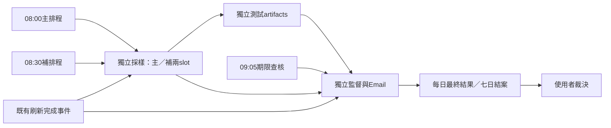

# 台灣來源七天自動觀察方案 V4（08:00／08:30）

使用者於2026-10-22明確要求主採樣08:00、補採樣08:30，並完成S03實際鏈路驗收。
本版同時將補採樣截止移到08:50、報告期限核對移到09:05、備援核對至09:20；
全為Asia/Taipei，UTC cron為00:00／00:30／01:05。

08:00首次run在intent前零效果失敗，API查詢修復後以08:12啟用點明確分版；原紀錄保留。
新實驗`twso-20261022-0800-v3-20261022t001200z`固定10/22～10/28七個日曆日；使用者接手D7核查及
最晚10/29 D8臺北08:00異常停用。原10/23起日與06:00／06:30版僅留歷史，
不把先前D0空報告混入本次來源或通知ledger。

[評估契約v2](SOURCE_EVALUATION_CONTRACT_20261022.md)僅修訂時窗／日曆；
品質門檻、分母、抽樣、七日長度與通知不明不重送不變。
code SHA與確切workflow指紋、實際run／artifact／郵件驗收見[S03狀態](SOURCE_GOVERNANCE_S03_STATUS_20261022.md)。
SMTP兩封範例已實收，日報自動化已退役；本實驗不恢復私人日報。正式來源與排序不改。
10/22主補、真SMTP250與自然喚醒去重已真驗；使用者已確認當日D1郵件實收，S03完成。
當日來源unmet如實保留；下一步見[S04交接](SOURCE_GOVERNANCE_S04_HANDOFF_20261022.md)。

以下為目前適用的操作設計；先前建置步驟01～03與v1／v3交接保留作歷史。

## 步驟與模型交接

| 步驟 | 本輪產物與完成條件 | 結束時提示的下一步模型／思考強度 |
| --- | --- | --- |
| 1 觸發與補試語意 | 08:00／08:30、有效成功、最多兩slot、避免重抓與日期邊界 | 步驟2：GPT-6.1 Sol（gpt-6.1-sol）／High |
| 2 心跳與隔離架構 | 既有完成事件唯讀旁接、兩workflow、缺測偵測、正式管線不變 | 步驟3：GPT-6.1 Sol（gpt-6.1-sol）／High |
| 3 Email與七日結案 | 每日最終回報、投遞紀錄、缺測／通知錯誤、結案與自停閘門已本機實作 | 下一步部署前隔離與故障審查：GPT-6 Astra（gpt-6-astra）／High |

以上是針對此工作的建議，不代表已切換目前模型或啟動其他agent。實作中的
併發、失敗補試與通知投遞需要High；例行讀報可用Sol／Medium。官方對effort
的定義可見 [OpenAI Docs](https://developers.openai.com/api/docs/guides/reasoning)，
型號可用性以此主機清單為準；本方案不在每日GitHub工作中呼叫任何OpenAI API。

## 步驟1：08:00主觸發、08:30補觸發

所有時刻是Asia/Taipei；UTC排程分別為同一UTC日的00:00、00:30。

| 時刻／窗口 | 動作 | 已完成時 |
| --- | --- | --- |
| 08:00 | 採樣workflow主排程；主slot容許08:00～08:30前開始 | 不再抓 |
| 08:30 | 檢查主結果；主未觸發或可恢復失敗才開補slot | 跳過，不重寄報告 |
| 08:30～08:50前 | 首個合格心跳完成事件可代補觸發；仍用同一補slot | 只讀檢查 |
| 09:05 | 獨立監督workflow做期限查核，不抓來源；缺結果也要寄失敗／缺測回報 | 查是否已寄，避免重複 |
| 09:05～09:20前 | 既有完成事件可喚醒監督，補09:05查核漏觸發 | 只補未完成回報 |

採樣job硬上限10分鐘，補slot最晚08:50前開始，以09:00前結束為目標；
09:05查核留五分鐘餘裕。GitHub有排隊與漏觸發，以上是目標，不保證準點。

### 一份每日觀察、最多兩個嘗試slot

- 主／補slot各一個intent，鍵為experiment＋臺北日期＋slot。先保存intent再抓。
- 主已保存完整結果：補slot不抓。主仍在執行：不取消、不並發重抓，序列化後
  重查結果；若已超過補slot開始窗口，僅保留未達標紀錄。
- 主沒有開始：08:30直接以補slot做當日首次實際採樣，保留「主觸發缺失」原因。
- 主暫時失敗：只補有需要的部分；已保存且驗證的來源資料沿用，缺baseline時
  只補讀最新公開baseline，不為此強制刷新正式Radar。
- 403／robots禁止／付費牆／未找到原生feed不當成暫時錯誤來反覆重試。
  資安人、Meet已知限制仍記錄，不為讓報告變綠增加替代抓法。
- 若主抓完卻未能保存、或runner崩潰，補slot可做一次新採樣；標記重抓原因，
  不承諾每站HTTP恰好一次。每天最多主＋補兩slot；不加第三次來源採樣。
- 同一slot的rerun不重新抓已標intent的未知結果；恢復交由另一slot。若主已有
  可驗證結果但Email失敗，只重試通知，不能重跑採樣。
- 每站保留真實retrieved_at與所用baseline；08:30補回的資料不假裝08:00取得。
  不改原有新聞／日報窗口，不回填昨天，七天缺測也不延長到湊滿七筆。

### 成功的判定

| 狀態 | 定義／補試 |
| --- | --- |
| 完成 | 五站都有診斷、可用feed均解析完成（有效空feed也算）、baseline合格且artifact驗證成功；不要求所有候選站都必須有feed |
| 完成但有已知來源限制 | 資安人／Meet等限制如實保存；Email標示限制，不假稱五站全可用 |
| 暫時未完成 | timeout／5xx、可恢復解析錯誤、baseline缺失／過舊（建議>2h）或保存失敗；補slot視需要恢復 |
| 未達標／部分完成 | 補slot後仍不完整；保留部分證據，Email不是成功 |
| 缺測 | 沒有真正採樣／只剩中斷intent；不能當零則成功 |

每日邏輯結果與Actions的綠燈分開。artifact已存不代表來源健康；所有可用feed
都失效也不能稱觀察成功。主slot失敗先等補slot，不立刻寄一天兩封結果通知。

**步驟1完成後：下一步建議GPT-6.1 Sol（gpt-6.1-sol）／High。**

## 步驟2：既有心跳旁接與兩個獨立workflow

建議採「08:00／08:30專用cron＋既有刷新完成事件補洞」，不改外部cron-job.org
任務、不換原PAT、不調整update-news.yml、watchdog.yml或私人日報trigger。

| 新增workflow | 觸發 | 工作／權限 |
| --- | --- | --- |
| TW source shadow observation | 08:00、08:30 cron；Update AI News Snapshot完成事件；受限手動入口 | 主／補採樣、當日bundle；contents:read、actions:read |
| TW source shadow report | 採樣workflow完成事件；09:05 cron；正式刷新完成事件作查核備援 | 獨立檢查缺測、彙整、Email；寄信job只讀；結案後獨立自停job取得actions:write |

既有外部心跳的接法是：cron-job.org約:05／:35叫正式刷新，該工作完成時
觸發新的觀察／監督工作。這只是把已發生的完成事件當喚醒訊號，不要求正式
刷新成功、不把其綠燈當新快照，也不能從workflow_run就斷言一定來自外部心跳。

只接受同repo／master、上游原事件為schedule或workflow_dispatch的完成訊號，
不讀PR內容或上游artifact作程式，只執行鎖定SHA的已核准程式。成功／失敗的
上游完成都可作pulse；依本工作的日期、窗口與每日狀態判定是否動作。

正常每天可有多個控制訊號，但實際來源抓取最多兩slot。job層先過濾上游UTC
時間與repo，程式再核對真實開工時間；其他時段只跳過，避免全日重複配置runner。
兩個新workflow各用獨立concurrency group，不佔用正式refresh／digest的group。
採樣失敗／取消後由另一個workflow判讀，不靠同一失敗工作最後一步必定能執行。

GitHub官方支援workflow_run完成事件接續工作，並可依conclusion分流。
[官方事件文件](https://docs.github.com/en/actions/reference/workflows-and-actions/events-that-trigger-workflows#workflow_run)

這條心跳接法能降低單一cron漏觸發的影響，仍依賴GitHub執行平台；若GitHub
與所有可用觸發都停擺，無法在GitHub裡自己準時寄「沒有啟動」通知。恢復後
查核會補寄明確標為延遲的回報，不補造採樣。若要求平台整體停擺也有準時Email，
需另設獨立外部監督；本次最小版不建立該服務，也不把既有HTTP 2xx當觀察完成。

**步驟2完成後：下一步建議GPT-6.1 Sol（gpt-6.1-sol）／High。**

## 步驟3：每日Email與通知紀錄

使用者已選Email，取代手機推播。專案目前未確認有可沿用的寄信服務；本輪
設計通知專用SMTP／Email API介面，收件者、寄件者、服務選擇與憑證留待部署
前一次填妥，不索取或傳送真實token，不默認可讀私人信箱。

### 寄送時間與內容

- 主完成：完成驗證後寄一封「成功」每日回報，包含已知受限來源。
- 主失敗：保留pending_recovery，不先寄終態失敗。補成功後寄「補試成功」。
- 補試仍失敗或09:05仍無合格結果：寄「未達標／部分完成／缺測」，不沉默。
- 第七天：先彙整七日證據，再將當日結果與七日結案連結合成一封Email；不
  自動準入、改排序或延長觀察。第七天完全漏觸發，恢復後只補partial結案。

主旨範例：`[TW來源觀察][D3/7][補試成功] 2026-10-24`。
內容只含日期、主／補實際時點、五站狀態／篇數、保存結果、錯誤原因、Actions
與artifact連結、待核事件數。成功也不能把候選數當新增事件。無新聞全文、
私人日報、私人Drive連結、OPML或token；寄信設定不進公開artifact。

每日通常一封最終結果。去重鍵固定為experiment＋日期＋daily-final，控制訊號
重複不重寄；若其後必須更正狀態，使用明確correction序號，不悄悄覆寫已寄結果。
實作中D7逾期但仍執行時，先寄未達標；完成後用final-correction-1補結案。
中斷後可將尚未通知日期合併一封延遲補報，不重寄結果不明的舊日期。
通知紀錄保存通知鍵、payload hash、provider回應與時間；不保存收件地址或憑證。
寄信前先保存notification intent；只有intent而沒有receipt時，必須檢查是否
已進入送出階段，不能當成從沒寄過。讀取歷史API失敗同樣不能冒充沒有紀錄。

### 寄信與觀察是兩種成功

| 狀態 | 意義 |
| --- | --- |
| observation_complete | 觀察證據合格，不代表Email已寄出 |
| notification_pending | 報告已備妥，尚待投遞 |
| provider_accepted | 寄信服務接受；不等於已進收件匣或手機已提示 |
| notification_failed | 連線／驗證／明確拒收等失敗，保留錯誤；不重抓來源 |
| delivery_unknown | 送出後斷線，無法知道是否已被接受；不能假稱未寄或直接無限重寄 |

通知專用secrets只進寄信job，不進來源採樣／正式刷新／私人日報。先保留
report，再寄Email。對確定尚未接受的暫時錯誤做有界重試，建議同通知最多
三次；收到明確接受後不重寄。SMTP沒有一般性的交易級冪等保證，若接受後
但寫入receipt前崩潰，要標unknown；若所選Email API提供冪等鍵，再使用該能力，
不能先承諾exactly-once。寄信系統本身停擺，也不能靠同一條Email保證告知其故障。

GitHub原生Actions Email可作額外執行狀態備援，但它不是本設計的客製每日報告，
也不保證檢出根本沒觸發的工作；不擅自更動使用者全帳號通知設定。
[GitHub官方通知設定](https://docs.github.com/en/subscriptions-and-notifications/how-tos/managing-github-actions-notifications)

部署前必須驗證一封成功範例、一封失敗範例的實際收件；沒有實際收件證據，
不能把「provider接受」或GitHub綠燈當成通知功能已驗收。

**步驟3完成後：下一步建置建議GPT-6.1 Sol（gpt-6.1-sol）／High。**
部署前隔離與故障審查可用GPT-6 Astra（gpt-6-astra）／High；不是每日依賴。

## 七日資料、結案與自停

固定核准D1～D7，不按成功次數延長。每個slot保留intent、capture、baseline、
manifest、report、測試／錯誤紀錄與hash；當日report引用成功來源實際來自哪個
slot，跨日按來源＋URL去重，不把主／補或連續出現同一篇當多個新事件。

結案包包括FINAL_REPORT.md、SOURCE_DAILY.csv（5站×7日期，含缺測）、
EVENT_REVIEW.csv、observations.json、逐日／slot證據及checksums。
當日baseline比較與結案回看聯集分開，不用未來報導偽裝當日已覆蓋。
人工未裁決時，新事件、新證據與人工誤收率維持未確認。

每包保留30天（不高於repo上限）。只用Actions artifacts，不回寫Git或cache；
公有repo的artifact不是私人儲存，不上傳全文／私人輸入。沿用既有影子工具
robots、固定host、timeout、每源50篇與不補全文／鏡像的規則。

報告包驗證保存後，寄出結案Email；取得明確provider接受才交給獨立自停job。
自停必須核對**結案Email**的receipt與報告hash，不接受任意一天的成功寄信紀錄。
該job只以actions:write停用以下兩個固定workflow，不checkout程式：
`tw-source-observation.yml`、`tw-source-report.yml`。無contents:write、Pages或
私人secret；Actions write實際為repo層級，所以只限自停job與固定命令。
若Email／自停失敗，日期閘門禁止D8再抓來源，只保留回報／結案恢復能力。

## 正式系統隔離與驗收清單

不修改TW_MEDIA_FEEDS、OPML、source_scope、分數／窗口／排序、日報生成／
Drive、正式刷新／watchdog／外部心跳設定，不dispatch正式刷新。新工作不會
觸發私人日報（它只監聽Update AI News Snapshot），也不增加新聞發布步驟。
所有產物在runner的$HOME/Downloads/tw-source-observation；checkout唯讀。

前後hash檢查正式scripts／config／data／所有現有workflows；未改變才通過。
新工作只用獨立concurrency與runner，但仍共享GitHub帳號資源，不宣稱零資源
影響。最多兩個採樣slot各10分鐘、監督／寄信job各5分鐘；部署前核對現有配額，
不自動購買容量。保留兩slot資料時，依目前baseline約6MB估算，七日與結案複本
最多約168MB未壓縮，實際以artifact壓縮大小為準。

建置後需實測／模擬：08:00成功、主未觸發、08:30cron失效由pulse補、主仍執行、
主部分成功只補失敗部分、兩slot同時排隊、補slot超時、09:05缺測、正式上游失敗
仍可喚醒、同日rerun、跨日拒補、baseline過舊、artifact失敗、SMTP拒收／接受後
斷線／receipt遺失、通知重複、D7漏觸發、Email未確認不得自停、自停API失敗。

原設計輪只有設定／YAML及狀態表驗證；其後步驟01／02／03增加真實離線程式測試，
不聲稱Actions接線、SMTP或線上七日已驗收。
本地草稿：設定disabled、日期／code SHA空白，兩份workflow草稿所有jobs硬性false，
草稿所呼叫的observe_tw_sources.py已實作prepare／collect／reconcile／notify／audit-stop；
SMTP、七日結案與自停閘門已本機驗收，所有jobs繼續停用。
後續建置驗收完成並核准後才部署；最後准入由使用者獨立裁決。

本輪草稿：[設定](examples/tw-source-observation.plan.json.example)、
[採樣workflow](examples/tw-source-observation.workflow.yml.example)、
[監督／Email workflow](examples/tw-source-report.workflow.yml.example)。
